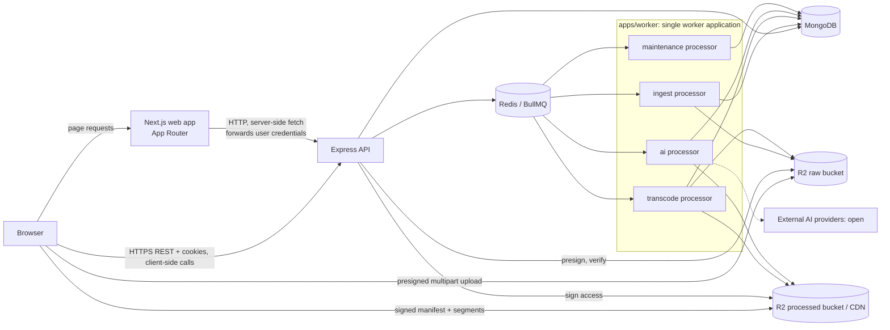
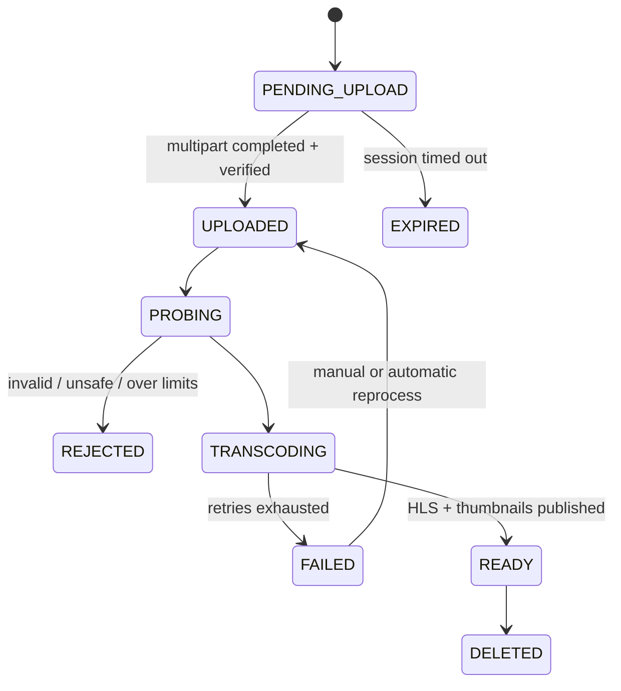
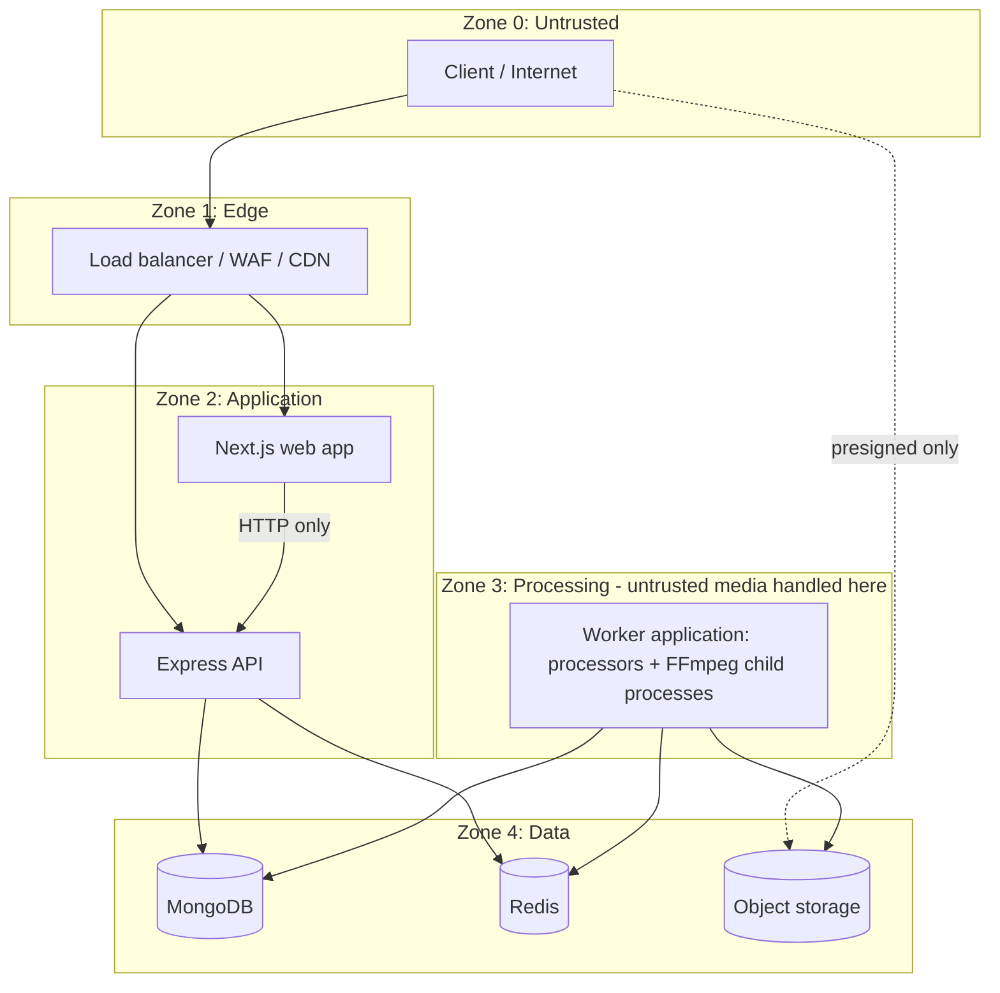
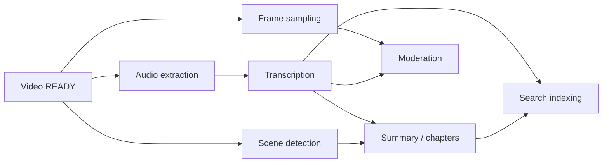

# Secure Intelligent Video Infrastructure: Architecture

> **Status:** Planning draft. No application code exists yet.
> **Last updated:** 2026-11-16 (rev 3: single worker app with processors, single-tenant MVP, 8 GB upload design; rev 2: Next.js frontend, Express API, R2, cookie auth)
> **Companion docs:** [PROJECT_OVERVIEW.md](./PROJECT_OVERVIEW.md) · [TECH_STACK.md](./TECH_STACK.md)

Status labels used throughout: ✅ **Confirmed** (decided by project owner), 🟡 **Proposed** (working default), ❓ **Open** (undecided).

---

## 1. Architectural principles

| # | Principle | Status |
|---|---|---|
| P1 | Modular TypeScript monorepo (pnpm + Turborepo) with explicit module boundaries | ✅ Confirmed |
| P2 | The worker application is separate from the API and from Next.js: it is never merged into Express and never runs inside Next.js | ✅ Confirmed |
| P2a | Three separate applications with distinct responsibilities: **Next.js** (`apps/web`: rendering, routing, UI), **Express** (`apps/api`: all business logic and the only backend API), **one worker application** (`apps/worker`: video and AI processing) | ✅ Confirmed |
| P2d | **One worker application with separate processors** (ingest, transcode, AI, maintenance). Each processor has independent queue configuration, concurrency and resource settings, and processors can later be split into separate deployables without redesign. | ✅ Confirmed |
| P2e | **Single-tenant MVP, designed for future multi-tenancy.** No multi-tenancy is implemented now; §6.7 lists the rules that preserve flexibility. | ✅ Confirmed |
| P2f | **Maximum supported upload size is 8 GB**, and the upload, ingest and transcode design must support it (§5.4). | ✅ Confirmed |
| P2b | Next.js reaches Express over HTTP only. Next.js API routes do not replace Express. Heavy processing never runs in Next.js request handlers. | ✅ Confirmed |
| P2c | The web app holds no MongoDB, Redis or R2 credentials | 🟡 Proposed |
| P3 | Media bytes never flow through the API: clients talk to object storage directly via presigned URLs | 🟡 Proposed |
| P4 | All media buckets are private; access is always authorized and time-limited | 🟡 Proposed |
| P5 | Uploaded media is untrusted input; FFmpeg runs in a constrained environment | 🟡 Proposed |
| P6 | Pipeline stages are idempotent and safe to retry | 🟡 Proposed |
| P7 | AI enrichment is asynchronous and never blocks playback readiness | 🟡 Proposed |
| P8 | Modules communicate via typed interfaces and queue payloads, not shared database access | 🟡 Proposed |
| P9 | Source of truth for state is MongoDB; Redis holds only reconstructible state | 🟡 Proposed |

## 2. System context



## 3. Monorepo layout (🟡 Proposed)

```
/
├── apps/
│   ├── web/                  # Next.js (App Router) + Tailwind + shadcn/ui
│   ├── api/                  # Express API (TypeScript)
│   └── worker/               # SINGLE worker application (separate from web and api)
│       ├── core/             # bootstrap, per-processor config loading, health/metrics, graceful shutdown
│       └── processors/
│           ├── ingest/       # validate + probe
│           ├── transcode/    # FFmpeg renditions + HLS packaging
│           ├── ai/           # AI pipeline stages
│           └── maintenance/  # cleanup, retention, re-processing
├── packages/
│   ├── contracts/            # browser-safe Zod schemas + API types (used by web, api, workers)
│   ├── shared/               # server-side config, logging, errors (never imported by web)
│   ├── auth/                 # identity, tokens, refresh rotation, RBAC (server-only)
│   ├── videos/               # domain model, state machine
│   ├── uploads/              # upload sessions, multipart logic
│   ├── playback/             # playback authorization, signing
│   ├── pipeline/             # queue names, job schemas, flows
│   ├── storage/              # R2 (S3-compatible API) abstraction
│   └── ai/                   # stage interfaces, provider adapters
├── infra/                    # Docker, compose, deployment manifests
├── docs/
└── tooling/                  # lint/ts/test shared configs
```

**Dependency rules (🟡 Proposed):**

- `apps/*` may depend on `packages/*`; never on another app.
- Inside `apps/worker`, each processor may import only `apps/worker/core` and `packages/*`, never another processor.
- `apps/web` may import **only** `packages/contracts` (and a future UI package if one is created). It must not import `auth`, `videos`, `uploads`, `playback`, `pipeline`, `storage`, `ai` or `shared`, because those pull in server-only code (Mongoose, the R2 client, secrets). This keeps the Next.js bundle free of backend code and makes P2c enforceable.
- `packages/contracts` and `packages/shared` depend on nothing internal; `contracts` must also stay browser-safe (no Node-only imports).
- Domain packages (`videos`, `uploads`, `playback`, `auth`) must not import from `pipeline` job handlers; they may import payload schemas.
- Only `packages/storage` talks to the S3-compatible SDK (pointed at R2). Only domain packages own their Mongoose models and collections.
- Enforce with lint rules (import boundaries) and TypeScript project references. ❓ Tool choice open (see TECH_STACK.md).

## 4. Components

### 4.1 Web app (Next.js, App Router) ✅ technology, 🟡 conventions below

**Responsible for:** server rendering, routing, layouts, UI composition, client-side interactivity (upload UI, player), and session-aware navigation.

**Not responsible for (hard rules):**
- Business logic, authorization decisions, or data persistence. Express owns these.
- Any MongoDB, Redis, BullMQ or R2 access.
- FFmpeg, transcoding, AI inference or any long-running work. Nothing heavy runs in Server Components, Route Handlers, Server Actions or middleware.
- Replacing Express: **no Next.js API routes implement product endpoints.** (Route Handlers, if used at all, are limited to framework-level plumbing such as health checks.)

#### Server Components vs Client Components (🟡 Proposed)

**Default to Server Components.** Add `"use client"` only at the smallest leaf that needs it.

| UI area | Component type | Reason |
|---|---|---|
| Root and section layouts, navigation shell, route structure | Server | No interactivity; keeps JS out of the bundle. |
| Video library list, video detail metadata, admin tables, search results page | Server | Data is fetched server-side from Express with the user's credentials; ships no data-fetching code to the browser. |
| Auth gates (redirect if no session) | Server (plus request interception, see §6.6) | Decide before rendering protected content. |
| Login, signup and metadata-edit forms | Client | Form state, validation feedback, submit to Express. |
| **Upload component** (file picker, multipart part uploads, progress, retry, abort) | Client | Uses `File`/`Blob` APIs, direct-to-R2 requests and long-lived state. |
| **Video player** (hls.js with native HLS fallback) | Client, loaded dynamically without SSR | Needs browser media APIs. |
| Processing-status badge or progress | Client | Polling or event subscription (open question A1). |
| Search input and filters | Client | Debounced input; submitting navigates to a Server Component results page. |
| shadcn/ui primitives that need state (dialogs, menus, toasts) | Client | Interactivity. |

Rules:
1. **Fetch on the server, mutate through Express.** Server Components read from Express. Mutations come from Client Components calling the Express API directly. 🟡 **Server Actions are not used for business mutations,** so Express remains the only mutation surface and the only place authorization lives. ❓ Revisit only if a clear need appears.
2. User-specific data is never cached across users: fetches that depend on the user's session use no-store or per-request semantics. Public or shared reference data may use the Next.js cache with explicit revalidation. ❓ Exact caching policy to be defined at implementation.
3. Server-side API client code is marked server-only so it cannot be bundled into Client Components.
4. Props crossing from Server to Client Components must be serializable and must never include tokens, secrets or storage credentials.
5. Only non-secret values use the public environment prefix. Express base URLs for server-side use are plain server environment variables.
6. Validation uses the same Zod schemas from `packages/contracts` on both sides, but **Express always re-validates**: client-side validation is for UX only.

### 4.2 API service (Express + TypeScript)
- The single, dedicated backend API. All business rules and authorization live here.
- Authentication (login, logout, refresh rotation) and authorization on every request (see §6.6).
- Request validation with Zod schemas at the boundary.
- Upload session lifecycle (create, complete, abort).
- Playback authorization and signed-access issuing.
- Enqueues jobs; never executes FFmpeg or AI inference.
- Exposes health and readiness endpoints.
- Baseline middleware (🟡 Proposed): security headers, strict CORS (only if the cross-origin topology is chosen), body size limits, Redis-backed rate limiting, structured request logging, centralized error handling.

### 4.3 Worker application (`apps/worker`) ✅ one application with separate processors, 🟡 details

There is **one worker application**, `apps/worker`, containing **four separate processors**. The worker application is separate from Next.js and Express: it is never merged into the API and never runs inside Next.js. (Earlier revisions described four separate worker applications; that is superseded.)

| Processor | Queue(s) | Resource profile | Notes |
|---|---|---|---|
| **ingest** | `ingest` | Low CPU, short jobs; reads the full source for validation and checksum checks | Fast validation should not wait behind long transcodes. |
| **transcode** | `transcode`, `package` | CPU heavy, high memory, large scratch disk (sized for 8 GB sources, §5.4) | FFmpeg is the primary load and failure domain. |
| **ai** | `ai.<stage>` (one queue per stage) | Mixed; may need GPU; may need external egress | Different hardware and network needs are the most likely reason to split later. |
| **maintenance** | `maintenance` | Minimal | Scheduled and housekeeping work (orphan cleanup, retention, re-processing). |

#### Per-processor configuration (🟡 Proposed)

Every processor has its own validated configuration (Zod), loaded at startup. Nothing is shared between processors except the `core` bootstrap code.

| Setting group | Examples | Why it is per-processor |
|---|---|---|
| **Queue configuration** | queue names and prefix, default job options (attempts, backoff, retention of completed/failed jobs), rate limiter, lock duration and stalled-job settings | An 8 GB transcode needs a very different lock duration and retry policy from a short ingest check. |
| **Concurrency** | number of jobs processed in parallel, set separately for each queue | Transcode concurrency is bounded by CPU and disk; ingest and maintenance can run wider. |
| **Resource requirements** | scratch directory and disk budget, FFmpeg thread count and maximum parallel FFmpeg processes, child-process timeouts, memory ceilings, GPU requirement (AI), provider and egress allow-list (AI) | Resource needs differ by orders of magnitude between processors and must be tuned independently. |
| **Enablement** | which processors this running instance starts | Enables the split described below with no code change. |

#### Worker rules (🟡 Proposed)
- The worker application never shares a process or container with Next.js or Express, and exposes no public HTTP, only an internal health/metrics port (reporting status per processor).
- **Processors do not import each other.** They share only `apps/worker/core` and the packages, and communicate only through queues. This is enforced by lint rules (see §3) and is what keeps a later split cheap.
- Each queue gets its own BullMQ worker instance, so concurrency settings are independent.
- CPU-heavy work (FFmpeg, `ffprobe`, local inference) runs in **child processes**, never on the Node event loop, so a long transcode cannot stall the ingest processor sharing the same Node process.
- FFmpeg exists **only** in the worker image. The Next.js and Express images contain no media tooling.
- Workers are stateless: scratch space is local and disposable; results are committed to R2 and MongoDB.
- Graceful shutdown per processor: stop taking jobs, finish or release in-flight work.
- Scheduled maintenance jobs use BullMQ repeatable scheduling so that running several instances does not duplicate them.

#### Deployment shape and future split (❓ Q21)

The `processors enabled` setting means the **same worker image can be started multiple times with different processor sets** (for example one deployment running only `transcode`, another running `ingest`, `ai` and `maintenance`). The configuration surface is therefore the split mechanism: splitting a processor out starts with changing configuration and deployment, not code.

Be clear about the limits of the single-application model:
- Concurrency and scratch budgets are application-level limits. **Hard isolation (CPU/memory cgroups, network egress rules, GPU nodes) is per container**, so while several processors run in one container they share those limits.
- The AI processor may need external egress and the transcode processor (handling untrusted media) should have none (§6.2). Until they run in separate containers, a shared container would need the union of both. The recommended resolution is to run AI in its own instance of the same image as soon as external providers are used (Q7).

Triggers to split a processor into its own deployment (❓ thresholds open):
1. GPU or other hardware needs (AI).
2. Different egress or security policy (AI versus transcode).
3. Transcode load measurably delaying ingest or maintenance despite concurrency limits.
4. Different scaling curve or deployment cadence.

Only if the **build artifacts** must diverge (for example a GPU-specific image with different native dependencies) would a processor move into its own `apps/*` folder. Because processors already follow the no-cross-import rule, that move is mechanical.

### 4.4 Data stores

| Store | Role | Status |
|---|---|---|
| **MongoDB (via Mongoose)** | System of record: users, videos, upload sessions, renditions, refresh-token records, AI results, audit events (single tenant in the MVP, §6.7) | ✅ |
| **Redis** | BullMQ queues, rate limiting, short-lived caches, locks | ✅ |
| **Cloudflare R2** (S3-compatible API) | Raw uploads, renditions, HLS output, thumbnails, AI artifacts | ✅ |

## 5. Upload-to-playback flow

### 5.1 Video state machine (🟡 Proposed)



AI processing is tracked separately per stage (see §7) so a video is `READY` for playback independently of AI completion.

### 5.2 Step-by-step (🟡 Proposed)

1. **Create upload session.** The upload Client Component calls the Express API (`POST /uploads`) with filename, size and content type, sending the auth cookies (§6.6). The API authenticates, checks role and quota, **rejects any declared size above the 8 GB maximum**, creates a `Video` (`PENDING_UPLOAD`) and an `UploadSession`, initiates a multipart upload on R2, and returns the **server-chosen part size**, the total part count and the session ID (§5.4).
2. **Direct upload.** The browser uploads parts straight to the **R2 raw bucket**, in parallel, with per-part retry. Part URLs are issued in short-lived batches on request (`POST /uploads/:id/parts`) so multi-hour uploads do not outlive their URLs. Parts can be resumed after interruption. No video bytes touch Next.js or Express. Requests to R2 carry no auth cookies, and the R2 bucket needs a CORS policy allowing the web origin.
3. **Complete upload.** The client calls `POST /uploads/:id/complete` with part numbers and ETags. The API verifies the parts against R2 (part sizes and total size) and completes the multipart upload, then checks the final object size against the declared size and the 8 GB maximum (and a checksum if one is adopted, Q19). Mismatches abort the upload and delete the object. On success the video moves to `UPLOADED` and an `ingest` job is enqueued.
4. **Ingest and probe.** The worker application's **ingest processor** runs `ffprobe`, re-checks size against the 8 GB maximum, checks container and codec allow-lists, duration/resolution limits, and stream sanity. Failure sets `REJECTED` with a reason. Success records source metadata and enqueues `transcode`.
5. **Transcode and package.** The **transcode processor** downloads the source to scratch (sized for 8 GB sources, §5.4), produces the rendition ladder, HLS playlists and segments, a poster and thumbnails. Outputs are uploaded to the **processed bucket** under a versioned key prefix. A final step writes the master playlist and renditions records.
6. **Mark ready.** The video moves to `READY` and fan-out jobs for the AI pipeline are enqueued.
7. **Notify client.** The client learns of status changes. ❓ Polling vs Server-Sent Events vs WebSocket is open.
8. **Request playback.** The page (a Server Component) loads video metadata from Express; the player Client Component then calls `POST /videos/:id/playback`. The API evaluates policy, then returns short-lived signed access (mechanism in §6.4).
9. **Stream.** `hls.js` (or native HLS) in the browser fetches the master playlist, renditions and segments using the signed access, directly from R2 or the CDN in front of it. Video bytes never pass through Next.js or Express.
10. **Retention.** After a configured period, the **maintenance processor** deletes or archives the raw source per policy. ❓ Retention duration is open.

### 5.3 Failure handling (🟡 Proposed)

- BullMQ retries with exponential backoff per queue.
- Jobs that exhaust retries go to a dead-letter path and set the video to `FAILED` with a diagnosable reason.
- Stage handlers are idempotent: outputs use deterministic keys, and re-running overwrites the same keys.
- Stalled-job detection enabled; long jobs report progress.
- Orphaned and expired multipart uploads are aborted by the maintenance processor, and an R2 lifecycle rule is added as a safety net.

### 5.4 Large uploads: 8 GB maximum ✅ requirement, 🟡 design, ❓ details

**Requirement (✅ C17):** uploads up to **8 GB** must be supported end to end; larger uploads are rejected. Interpretation of "8 GB" is ❓ (Q19). Until answered, the design and tests target **8 GiB = 8,589,934,592 bytes**, which also covers 8,000,000,000 bytes.

#### Cloudflare R2 multipart constraints (checked against Cloudflare documentation on 2026-11-16; re-verify in Phase 0)

| Constraint | Value | Implication for 8 GB |
|---|---|---|
| Minimum part size | 5 MiB (the last part may be smaller) | Not a constraint; our parts are far larger. |
| Maximum part size | 5 GiB | Not a constraint. |
| Maximum parts per upload | 10,000 | 8 GiB at the 5 MiB minimum is 1,639 parts, so the cap is not reached. |
| **All parts except the last must be the same size** | Required by R2 | The **server must choose one fixed part size per upload**; the client cannot pick arbitrary sizes. |
| Maximum object size | 5 TiB (one third-party summary quotes about 4.995 TiB; either is far above 8 GB) | Not a constraint. |
| Single-part PUT | Up to roughly 5 GiB; Cloudflare recommends single-part only for small files | **Multipart is mandatory** for a file over about 5 GiB, and in practice for any large video. |
| Incomplete multipart uploads | Auto-aborted after 7 days by default; configurable by lifecycle rule | Our upload-session expiry must be shorter than this; the maintenance processor aborts sooner. |

**Not confirmed by the documentation reviewed, therefore ❓ Phase 0 must verify:** that presigned URLs work for individual `UploadPart` requests from a browser (the docs show presigned URLs for single PUT uploads); whether the part size or `Content-Length` can be bound into the presigned signature; the CORS configuration needed so the browser can read each part's `ETag`; maximum presigned-URL lifetime; and presigned behavior behind a custom domain versus the S3 endpoint.

#### Design (🟡 Proposed)

| Aspect | Proposal |
|---|---|
| Part size | One fixed size per upload, chosen by Express at session creation and returned to the client with the total part count. Working assumption: **64 MiB** (8 GiB then needs 128 parts). Range under consideration: 16–128 MiB ❓. The client must slice exactly; only the final part may be smaller. Larger parts mean fewer requests but more data re-sent after a failure. |
| Parallelism and retry | A small number of parallel parts (for example 3–6 ❓), per-part retry with backoff, and resume of failed parts only. The upload code reads parts via `Blob` slices so the browser never holds the whole 8 GB file in memory (to be measured in Phase 0). Progress reporting method ❓. |
| Presigned URLs | Issued in **batches on demand**, each short-lived (lifetime ❓), rather than all up front. For scale: 8 GiB takes about 23 minutes at 50 Mbps and about 1.9 hours at 10 Mbps, so a single early expiry would break slow uploads. Each batch request goes through Express, so authorization is re-checked and the access cookie can refresh (§6.6). |
| Resume | The server and R2 are the source of truth. After a reload the client re-selects the same file, the API lists the parts R2 already holds, and only missing parts are uploaded. File identity is checked best-effort (name, size, last-modified) before resuming. |
| Session lifetime | Upload sessions expire after a set time ❓ (shorter than R2's 7-day default). Expired or cancelled sessions are aborted so R2 does not keep orphaned parts. |
| Size enforcement (defense in depth) | (1) Express rejects a declared size above 8 GB at session creation. (2) At completion, Express lists the parts and checks each size and the total against the declared size, then checks the final object size; a violation aborts or deletes. (3) The ingest processor re-checks size before any processing. A client cannot be trusted to honor the declared size, so check (2) is the real control. |
| Integrity | Baseline: per-part ETags, size match and a successful probe. R2 multipart ETags are not a hash of the whole file. Whether to add per-part or whole-file SHA-256 checksums (browser hashing of 8 GB has a CPU cost) is ❓ (Q19). |
| Quotas | Per-user concurrent-upload and storage limits ❓. |

#### Implications for the worker application (🟡)

| Concern | Consideration |
|---|---|
| Scratch disk | The transcode processor holds the 8 GiB source plus renditions and segments at once. **Initial planning estimate: budget roughly 3× the source size per concurrent job (about 24 GiB)** until Phase 0 measurements replace it. Total scratch is that figure times transcode concurrency. |
| Download cost | Ingest and transcode may each need the source. Whether they download it separately, share a local copy, or probe with ranged reads (which conflicts with the local-files-only FFmpeg rule in §6.3) is ❓ (A17). |
| Duration | Transcoding an 8 GB source can take a long time. The transcode processor needs a long lock duration or lock renewal, a per-job timeout, progress reporting, and restart-from-scratch idempotency (§5.3). Resume from a checkpoint is ❓. |
| Limits | Maximum duration, resolution and stream count must be set alongside the size limit (Q2, Q19). |
| Independence | The long-running transcode settings must not affect ingest or maintenance. This is why per-processor queue configuration and concurrency (§4.3) are required. |

#### Phase 0 verification and test requirements (✅ required; 🟡 pass criteria)

All checks run against a **real R2 bucket**, not only an emulator (Q16). Test files are synthetic and generated outside the repository.

| # | Check | Pass criteria |
|---|---|---|
| V1 | **Size boundaries** | A declared size at the limit is accepted; one byte above is rejected at session creation. Part count and part-size computation are correct for the limit, for small files and for sizes that leave a short final part. |
| V2 | **End-to-end 8 GiB browser upload** (Playwright against the web app) | Upload completes to R2; object size matches exactly; browser memory stays bounded (the file is not loaded whole); time, request count and failures are recorded. |
| V3 | **R2 part rules** | Confirm the equal-part-size rule (including a smaller last part), the 5 MiB minimum and the 10,000-part cap behave as documented. |
| V4 | **Per-part presigned URLs and CORS** | Presigned `UploadPart` works from a browser, the `ETag` is readable, expiry behaves as expected, batch refresh works, and whether part size can be bound into the signature is recorded. |
| V5 | **Resume** | After killing the tab or network mid-upload, the upload resumes from R2's part list and re-sends only missing parts. |
| V6 | **Abort and lifecycle** | Cancel and expiry abort the multipart upload; the lifecycle rule removes orphans; the default 7-day behavior is confirmed. |
| V7 | **Oversize defense** | A client that sends larger-than-declared parts or extra data is detected at completion and the object is removed. |
| V8 | **Integrity** | The completed object's size equals the declared size. The checksum options in Q19 are measured for cost and benefit. |
| V9 | **Worker at 8 GiB** | The worker downloads, probes and transcodes a representative 8 GiB source (for example high-bitrate 4K) on target hardware. Record duration, peak scratch, memory and CPU; confirm the job survives its lock/timeout settings. |
| V10 | **Processor independence** | With transcode jobs running, ingest and maintenance jobs still meet their latency expectations, confirming per-processor concurrency (informs Q21, Q22). |
| V11 | **Slow-link upload** | With throttled bandwidth (for example 10 Mbps, about 2 hours), the upload survives URL batch refresh and access-cookie refresh without failing. |
| V12 | **Bad input at size** | An 8 GiB non-video file and a truncated or malformed container are rejected by ingest without exhausting the worker. |

## 6. Storage and security boundaries

### 6.1 Bucket layout (🟡 Proposed)

| Bucket | Contents | Access |
|---|---|---|
| `raw` | Original uploads (quarantine until probed) | Write: client via presigned URL only. Read: ingest and transcode processors only. |
| `processed` | HLS playlists, segments, thumbnails, posters | Write: transcode processor. Read: via signed access only. |
| `artifacts` | AI outputs (transcripts, embeddings payloads, frames) | Write/read: AI processor and API (authorized). |

Key convention (🟡 Proposed): `{bucket}/{tenantId}/{videoId}/{version}/...`, where `tenantId` is a constant default value in the single-tenant MVP (§6.7). Keys are never derived from user-supplied filenames.

Storage is **Cloudflare R2** ✅, accessed through its S3-compatible API by `packages/storage` only. The multipart limits relevant to the 8 GB requirement were checked against Cloudflare documentation and are recorded in §5.4. Items not confirmed by that documentation (per-part presigned URLs, CORS details, presigned behavior behind a custom domain, HLS segment authorization) remain ❓ **to be verified in the Phase 0 spike** (§5.4, checks V3 to V6). The raw and processed buckets must not have public access enabled.

### 6.2 Trust zones



Boundary rules (🟡 Proposed):
- MongoDB and Redis accept connections only from the Express API and workers, never from the internet and never from Next.js.
- The Next.js app has network access to Express (internal URL) and nothing else in the data zone. It holds no database, queue or R2 credentials.
- The worker application has no inbound traffic from clients.
- The processing zone has restricted egress. Only the AI processor may reach external providers, and only to an allow-list. ❓ depends on AI deployment decision (Q7). Because egress policy is enforced per container, this implies running the AI processor as its own instance of the worker image once external providers are used (§4.3, Q21).

### 6.3 Handling untrusted media (🟡 Proposed)

- Validate by probing actual content, not by trusting file extension or declared MIME type.
- Run FFmpeg as a non-root user, in a container with CPU, memory, time and scratch-disk limits.
- Restrict FFmpeg protocols to local files (for example via `-protocol_whitelist`) so crafted inputs cannot trigger network reads.
- Enforce hard limits on duration, resolution, size and stream count before transcoding.
- Keep the raw bucket separate from the processed bucket so an unvalidated file is never served.
- Consider malware scanning of uploads. ❓ Open.

### 6.4 Playback authorization (🟡 Proposed, ❓ mechanism open)

Candidate mechanisms, in increasing strength:

1. Short-lived signed URLs for the manifest, with rewritten segment URLs.
2. Signed cookies or CDN-signed tokens scoped to a video's key prefix.
3. HLS AES-128 encryption with a key endpoint protected by the API.
4. Full DRM.

**Working assumption:** option 2, optionally combined with 3. ❓ Final choice depends on Q4 (DRM), Q5 (anonymous playback) and Q6 (CDN).

**R2 consideration (❓ verify in the Phase 0 spike):** HLS needs authorized access to many segment files, not one object. Candidate approaches on R2 are (a) the API issues a playlist whose segment URLs are individually presigned, (b) a Cloudflare-fronted custom domain that validates a signed token or cookie scoped to a video's key prefix, or (c) a hybrid. Which of these R2 and Cloudflare support cleanly for presigned URLs behind a custom domain has not been confirmed here and must be checked against current Cloudflare documentation before choosing.

### 6.5 Application security baseline (🟡 Proposed)

- RBAC with authorization checks on every resource access, evaluated against a tenant context (a single default tenant in the MVP, §6.7).
- Input validation at the API boundary using shared schemas.
- Rate limiting (Redis-backed) on authentication, upload-session creation and playback issuance.
- Secrets from environment or a secret manager, never committed.
- TLS everywhere; encryption at rest on database and object storage.
- Audit log of sensitive actions (login, upload, playback grant, delete, role change).
- Dependency and container image scanning in CI.
- Least-privilege credentials per component: API cannot read raw media; the worker application cannot issue user tokens.

### 6.6 Authentication, cookies and API requests across Next.js and Express

**Confirmed (✅):** JWT access tokens plus **rotating refresh tokens**, delivered in **secure cookies**. Express is the only issuer and verifier of tokens. Everything else in this section is 🟡 Proposed or ❓ Open.

#### Token and cookie design (🟡 Proposed)

| Item | Proposal |
|---|---|
| Access token | Short-lived signed JWT (claims: subject, tenant, roles, token ID, expiry; the tenant claim is a constant default value in the single-tenant MVP, §6.7). Lifetime ❓ (Q18). |
| Refresh token | Opaque random value, not a JWT. Only a **hash** is stored in MongoDB (`refreshTokens`: token family ID, hash, expiry, replaced-by, revoked, user agent, created-at). |
| Rotation | Every refresh issues a new refresh token and invalidates the old one. |
| Reuse detection | Presenting an already-rotated refresh token revokes the whole token family and forces re-login. A small grace window for legitimate parallel requests is ❓ (Q18). |
| Cookie attributes | `HttpOnly`, `Secure`, `SameSite=Lax` (or `Strict` if navigation flows allow), no tokens in `localStorage` or `sessionStorage`. |
| Cookie scope | With the single-origin topology below: host-only cookies (no `Domain`), allowing `__Host-` prefixed names for the access cookie. Refresh cookie `Path` is ❓ (see trade-off below). |
| Who sets cookies | **Express only**, on login and refresh, via `Set-Cookie`. Logout clears the cookies and revokes the token family. |
| Signing | Algorithm and key rotation ❓ (Q18). Keys live only in Express (and workers if they verify tokens). Next.js never needs the signing key. |

#### Edge topology (❓ Q17, working assumption: single origin)

| Option | How it works | Pros | Cons |
|---|---|---|---|
| **A. Single origin, path routing** (working assumption) | A reverse proxy or ingress in front routes `/api/*` to Express and everything else to Next.js, so the browser sees one origin. | No CORS for app traffic, host-only cookies, simplest CSRF story. | Requires an edge component; local dev needs an equivalent proxy or Next.js rewrites. |
| **B. Sibling subdomains** | `app.example.com` (Next.js) and `api.example.com` (Express), cookies with `Domain=.example.com`. | Independent hosting and scaling. | Needs strict CORS with credentials; broader cookie scope; more CSRF surface. |

Using Next.js rewrites to proxy all API traffic in production is **discouraged**: it routes every API call through the Next.js process and couples their scaling. Rewrites are acceptable as a local-development convenience only. Either topology keeps Express as the sole API implementation.

#### How requests flow (topology A)

| # | Path | Behavior |
|---|---|---|
| 1 | **Login** | Browser form (Client Component) → `POST /api/auth/login` on Express → Express sets access and refresh cookies → client navigates. Next.js never sees the password handling logic. |
| 2 | **Page navigation** (protected route) | Browser → Next.js with cookies. Request interception (middleware, or the equivalent convention in the chosen Next.js version) checks whether the access cookie is missing or near expiry. |
| 3 | **Server-side data fetch** | A Server Component calls Express over the internal URL, forwarding the user's credentials (the access token as `Authorization: Bearer`, or the cookie header) using a server-only API client. Express authenticates and authorizes exactly as for any other client. Next.js never calls Express with a privileged service identity for user data. |
| 4 | **Client-side call** | Client Components call `/api/...` on the same origin; the browser attaches cookies automatically. Responses and errors use the shared contract types. |
| 5 | **Refresh** | See below. |
| 6 | **Upload and playback bytes** | Browser ↔ R2 directly using presigned or signed access. No cookies are sent to R2. |
| 7 | **Logout** | `POST /api/auth/logout` on Express revokes the family and clears cookies. |

#### The refresh problem in Server Components (🟡 Proposed approach)

Server Components cannot set cookies. If an access token expires during a server-rendered navigation, the refreshed cookies must be written somewhere that can set them. Proposed approach:

1. Request interception runs before rendering. If the access cookie is missing or close to expiry and a refresh cookie is present, it calls Express `POST /api/auth/refresh` server-to-server, forwarding the refresh cookie.
2. It copies the new `Set-Cookie` values onto both the outgoing response (so the browser stores them) and the request that continues to rendering (so the Server Components in the same request use the new access token).
3. Client-side 401 responses trigger a single shared refresh attempt from the browser (calling Express directly), de-duplicated so parallel requests do not each rotate the token.

Trade-off ❓ (Q18): step 1 requires the refresh cookie to be sent on page navigations, so it needs `Path=/`. The alternative is a narrowly scoped refresh cookie (path limited to the auth endpoints), which reduces exposure but means server-side refresh is impossible and an expired session must go through a client-side refresh page. The working assumption is `Path=/` with `HttpOnly`, `Secure` and rotation plus reuse detection as compensating controls.

#### CSRF and related controls (🟡 Proposed)
- `SameSite` cookies as the first defence.
- Express rejects state-changing requests (anything other than GET/HEAD/OPTIONS) whose `Origin` (or `Sec-Fetch-Site`) does not match the allowed web origin, and may additionally require a custom header from the client.
- CORS is disabled in topology A and strictly allow-listed with credentials in topology B. Never `*` with credentials.
- Rate limiting on login, refresh and registration, keyed by IP and account.
- Access-token role claims can be stale until expiry; sensitive actions re-check authorization against MongoDB.
- Security-relevant events (login, refresh reuse detected, logout, role change) are written to the audit log.

### 6.7 Tenancy: single-tenant MVP, designed for future multi-tenancy ✅ decision, 🟡 rules

**Confirmed (✅ C16):** the MVP is **single-tenant**. Multi-tenancy is **not implemented now**. The architecture must not make it unnecessarily hard to add later.

**Not built in the MVP:** tenant creation or management, tenant switching, per-tenant buckets or databases, tenant-aware routing or subdomains, per-tenant quotas or billing, cross-tenant administration.

**Why this needs deciding now:** R2 has no rename operation, so changing storage key conventions later means copying objects, which is expensive for videos up to 8 GB. Key layout and data shape are the cheap-now, costly-later decisions.

Flexibility rules (🟡 Proposed; adoption is ❓ Q20):

| # | Rule | Reason |
|---|---|---|
| T1 | A `tenantId` concept exists. In the MVP it is one constant default value. | Keeps tenant a first-class idea without any tenant management. |
| T2 | **Every collection in §8 stores its own `tenantId`:** `users`, `videos`, `uploadSessions`, `renditions`, `aiResults`, `auditEvents`, `jobRecords` and `refreshTokens`. Scope is never inherited implicitly through a join. How each value is set and enforced is in the §8 table and invariants. | Avoids a backfill migration later and keeps every query tenant-filterable without lookups. |
| T3 | R2 keys include a tenant segment: `{bucket}/{tenantId}/{videoId}/...` (§6.1). | Avoids copying large objects later; keeps both shared-bucket and per-tenant-prefix policies possible. |
| T4 | Tenant context is resolved in **one place** in Express from the verified token (never from client input) and passed explicitly to data-access and storage code. | A single place to change when real tenancy arrives. |
| T5 | Repositories and `packages/storage` take the tenant context and build queries and keys from it. No domain code hard-codes paths or omits the tenant filter. | Prevents accidental cross-tenant access later. |
| T6 | Queue payloads carry `tenantId`, and processors pass it through to storage and database calls. | Lets processors work per tenant later without payload changes. |
| T7 | Per-tenant settings (limits, retention, AI enablement, budgets) are read through a settings lookup keyed by tenant, returning the single deployment-level settings for now. | Today's global settings become per-tenant defaults without call-site changes. |
| T8 | Natural uniqueness constraints and indexes lead with `tenantId` where that costs nothing. | Avoids index rebuilds later. |

Future isolation models (deferred, ❓ Q20): shared database and buckets keyed by tenant; per-tenant buckets with a shared database; or per-tenant databases. Rules T1 to T8 are compatible with all three. Choosing among them is out of scope until multi-tenancy is actually planned.

Single-tenant consequences for the rest of this document: there is one Administrator role scope, no organization or membership model, and authorization checks use the tenant context but have only one tenant to resolve to.

## 7. AI pipeline

### 7.1 Design (🟡 Proposed)

- Runs **after** the video is `READY`, as independent jobs, so playback is never gated on AI.
- Each stage is its own BullMQ queue and its own status record, so one failing stage does not affect the others.
- Stages sit behind a provider-agnostic interface in `packages/ai`, so model or vendor changes do not ripple through the codebase.
- Inputs are derived artifacts (extracted audio, sampled frames), not the original upload.
- Every result stores provenance: stage, provider, model identifier, version, timestamp.

### 7.2 Candidate stages (❓ which are mandatory is open, Q8)

| Stage | Input | Output | Notes |
|---|---|---|---|
| **Audio extraction** | Source/rendition | Normalized audio file | Prerequisite for speech stages. |
| **Transcription** | Audio | Timestamped transcript, language | Self-hosted vs API is open (Q7). |
| **Scene / shot detection** | Video | Scene boundary timestamps | Can reuse FFmpeg filters. |
| **Frame sampling + visual tagging** | Frames | Labels, captions | Optional. |
| **Content moderation** | Frames + transcript | Flags with confidence | Feeds a review workflow. |
| **Summarization / chaptering** | Transcript + scenes | Summary, chapters | Depends on transcript. |
| **Embeddings / search indexing** | Transcript, captions | Vector or text index | Index store is open (see TECH_STACK.md). |

### 7.3 Flow



### 7.4 AI risks to design for (🟡 Proposed)
- Sending media to third parties may violate privacy or contractual constraints. Gate behind an explicit deployment-level setting (read through the tenant-keyed settings lookup, §6.7, so it can become per-tenant later). ❓ Q7.
- Cost control: budgets and stage-level enable flags, held in the same settings lookup.
- Non-determinism: store model versions so results are explainable and re-runnable.
- Moderation false positives and negatives: results are advisory and reviewable, not automatic deletion, unless decided otherwise.

## 8. Data model sketch (🟡 Proposed)

Collections are owned by their module. Fields are indicative, not final. In the single-tenant MVP, `tenantId` is one constant default value everywhere (§6.7); there are no tenant or membership collections and no tenant-management features.

| Collection | Owner module | Key fields | Tenant scoping (`tenantId` is explicit on every collection) |
|---|---|---|---|
| `users` | auth | identity, roles, **tenantId**, status | Set from the tenant context at creation. Never accepted from client input. Email or login uniqueness is defined per tenant (unique index leads with `tenantId`). |
| `refreshTokens` | auth | **tenantId**, userId, token family ID, token hash, expiry, replaced-by, revoked flag (see §6.6) | Copied from the owning user at issuance. On refresh, the token's `tenantId` must equal the user's `tenantId`, otherwise the family is revoked. The new access token's tenant claim comes from this verified record. |
| `videos` | videos | **tenantId**, ownerId, status, source metadata (declared and verified size), visibility, timestamps | Set from the tenant context at creation. Every read and write filters on `tenantId`. The owner must belong to the same tenant. |
| `uploadSessions` | uploads | **tenantId**, videoId, s3UploadId, expiresAt, parts, state | Copied from the parent `videos` document, never from the request. The R2 key prefix is built from the same value (T3), so database scope and storage scope cannot diverge. |
| `renditions` | videos | **tenantId**, videoId, label, codec, bitrate, resolution, storage key | Copied from the parent video by the transcode processor, using the `tenantId` in the job payload (T6). Storage key must start with that tenant segment. |
| `aiResults` | ai | **tenantId**, videoId, stage, status, provider, model, payload ref, provenance | Copied from the parent video via the job payload. Large payload objects live under the same tenant key prefix. |
| `auditEvents` | shared/auth | **tenantId**, actor, action, resource, ip, timestamp | Set from the tenant context of the acting user. For events with no authenticated user (for example a failed login), the MVP records the default tenant. Handling such pre-authentication events in a multi-tenant future, for example a null or platform scope, is ❓ part of Q20. |
| `jobRecords` | pipeline | **tenantId**, videoId, queue, attempts, last error (for operator visibility) | Copied from the job payload (T6). Operator views are the only cross-tenant reads anticipated in the future, and none exist in the MVP. |

**Tenant-scoping invariants (🟡 Proposed):**
1. `tenantId` is **always derived server-side**: from the verified token in Express, from the parent document, or from the job payload in the worker application. It is never read from request bodies, query strings or client-supplied headers.
2. A child document's `tenantId` must equal its parent's. Repositories assert this when creating the child, and processors re-check it against the job payload before writing.
3. Every repository query includes `tenantId` in its filter, and every unique index leads with `tenantId` where natural (T8). There is no unscoped query path in domain code.
4. `tenantId` is immutable after creation.
5. Scope is stored explicitly on every collection rather than inherited through `videoId` lookups. This keeps queries simple and indexable, avoids join-style scope checks that could be skipped, and leaves each future isolation option (shared collections, per-tenant databases or buckets) open (Q20).

Large AI payloads (full transcripts, embeddings) live in object storage with a reference in MongoDB, to keep documents small. ❓ Final split is open.

## 9. Observability and operations (🟡 Proposed)

- Structured JSON logs with `videoId`, `jobId` and `requestId` correlation.
- Metrics: queue depth, job latency by stage, failure rate, transcode duration versus media duration.
- Tracing across API → queue → worker via propagated correlation IDs.
- A queue inspection UI for operators, restricted to the internal network. ❓ tool choice open.
- Alerts on DLQ growth, stalled jobs and storage error rates.

## 10. Scaling notes (🟡 Proposed)

- API scales horizontally and is stateless.
- The worker application scales by running more instances of the same image. Each processor's concurrency is bounded separately by CPU, memory and scratch disk (§4.3); transcode is the one that matters most at 8 GB source sizes.
- When load or policy requires it, processors are scaled independently by starting instances with different enabled-processor sets (§4.3, Q21). GPU nodes are only needed if AI models are self-hosted.
- Redis persistence settings and eviction policy must suit BullMQ (queue data must not be evicted). ❓ managed vs self-hosted Redis is open.
- Large fan-out is bounded with per-queue rate limits.

## 11. Open questions specific to architecture

| # | Question |
|---|---|
| A1 | Status notification mechanism: polling, SSE or WebSocket? |
| A2 | Playback protection level and mechanism (see §6.4)? |
| A3 | ~~Tenant isolation model~~ **Resolved for the MVP: single-tenant (✅).** Which future-proofing rules in §6.7 are adopted now, and the preferred future isolation model (shared vs per-tenant buckets or databases), are open (Q20). |
| A4 | HLS segment container: fMP4/CMAF vs MPEG-TS? Is DASH also required? |
| A5 | Rendition ladder definition, and whether it is fixed or content-adaptive? |
| A6 | Where do large AI outputs live, and which store backs search? |
| A7 | Is malware scanning of uploads required? |
| A8 | How is FFmpeg sandboxed in production (container limits only, or additional isolation such as gVisor/Firecracker)? |
| A9 | Original-file retention and re-processing policy? |
| A10 | Do we need hardware-accelerated encoding? |
| A11 | Edge topology: single origin with path routing (A) or sibling subdomains (B)? (shared with Q17) |
| A12 | Refresh cookie scope: `Path=/` with server-side refresh in request interception, or path-limited cookie with client-side refresh only? Grace window for parallel refreshes? (shared with Q18) |
| A13 | Does Express accept both cookie and `Authorization: Bearer` credentials, or cookie only? |
| A14 | Next.js caching policy: which fetches are cacheable, and how are they revalidated? |
| A15 | R2 verification spike. Multipart size limits are now recorded (§5.4). Still open: per-part presigned URLs from a browser, signature binding of part size, CORS/`ETag` exposure, presigned lifetime, presigned behavior behind a custom domain, and the HLS segment authorization approach (§6.4). Checks V3 to V6. |
| A16 | Where is Next.js hosted (own Node container behind the same edge as Express, or a platform host)? This affects topology A feasibility. |

| A17 | How do ingest and transcode obtain an 8 GB source: separate downloads, a shared local copy, or ranged reads (conflicts with the local-files-only FFmpeg rule, §6.3)? |
| A18 | Initial worker deployment shape and the split triggers and thresholds (shared with Q21). |
| A19 | Part-size policy, concurrency, presigned lifetime, session expiry and integrity-check approach for 8 GB uploads (shared with Q19). |
| A20 | Which tenancy future-proofing rules (§6.7) are adopted now (shared with Q20). |

Shared questions Q1–Q22 are tracked in [PROJECT_OVERVIEW.md](./PROJECT_OVERVIEW.md).
