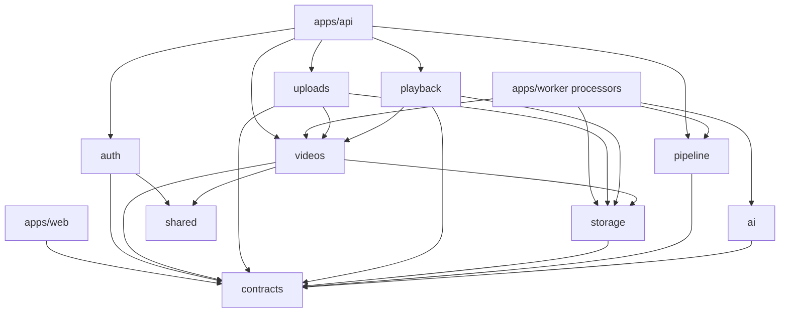

# Secure Intelligent Video Infrastructure: Monorepo Foundation Plan

> **Status:** Planning document for review. **Nothing described here has been created.** No folders, configuration files, packages or code exist yet.
> **Last updated:** 2026-11-17
> **Task:** S01-02. Prepared for the Technical Lead; implementation is a separate future task.
> **Source of truth:** [PROJECT_OVERVIEW.md](./PROJECT_OVERVIEW.md) · [ARCHITECTURE.md](./ARCHITECTURE.md) · [TECH_STACK.md](./TECH_STACK.md)

Status labels follow the approved documents: ✅ **Confirmed** (already decided), 🟡 **Proposed** (this plan's recommendation, awaiting review), ❓ **Open** (needs approval before implementation).

Everything marked ✅ below is restated from the approved documents and is not changed here. Everything marked 🟡 is new detail that this plan adds and that the Technical Lead should review. Section 10 lists the decisions that need approval.

---

## 0. Scope, approved constraints and conventions used in this plan

### 0.1 Approved decisions this plan relies on (✅, not changed)

| Area | Decision |
|---|---|
| Monorepo | pnpm workspaces + Turborepo, TypeScript throughout |
| Apps | `apps/web` (Next.js, App Router), `apps/api` (Express), `apps/worker` (one worker application) |
| Worker | One application with four processors (ingest, transcode, AI, maintenance), each with independent queue configuration, concurrency and resource settings. Separate from Next.js and Express. Splittable into separate deployables later. |
| Data and infra | MongoDB + Mongoose, Redis + BullMQ, Cloudflare R2, FFmpeg |
| UI and validation | Tailwind CSS + shadcn/ui, Zod |
| Testing | Vitest + Playwright |
| Tenancy | Single-tenant MVP, designed for future multi-tenancy. No multi-tenant functionality is built. |
| Upload | Maximum video upload size 8 GB |
| Prohibitions | No Vite as a frontend tool. Next.js API routes do not replace Express. The worker is never merged into the API or run inside Next.js. |

### 0.2 Conventions in this plan

- `@siv/*` is a **placeholder** package scope (see decision D1). It stands for "Secure Intelligent Video" and is not approved.
- Tree diagrams and the one `turbo.json` excerpt are **illustrative descriptions**. They are not files.
- Specific tool versions are deliberately not stated. They are chosen at implementation time and recorded in an ADR, consistent with TECH_STACK.md.
- Vitest is built on Vite internally. That is an implementation detail of the approved test runner and does not make Vite a frontend build tool; it is not used to build or serve any app.

### 0.3 Principles that shape the plan (🟡)

1. **Fewest moving parts.** Every config file and abstraction must earn its place. Where two designs work, the plan picks the simpler one and says so.
2. **Boundaries enforced by tooling, not convention.** The approved dependency rules (ARCHITECTURE.md §3) become checks that fail the build.
3. **Apps load configuration; packages receive it.** Only apps read environment variables. Packages take explicit configuration objects.
4. **Each app is independently startable and testable**, so the future processor split and the web/API separation stay cheap.

---

## 1. Proposed directory structure

### 1.1 Complete root layout (🟡)

```
/                                        # repository root (name TBD)
├── apps/
│   ├── web/                             # Next.js, App Router
│   │   ├── src/
│   │   │   ├── app/                     # routes, layouts, Server Components, route-level UI
│   │   │   ├── components/              # shadcn/ui primitives + feature components (Client Components at the leaves)
│   │   │   ├── lib/                     # server-only API client, small helpers
│   │   │   ├── env/                     # Zod validation: server env and public env kept separate
│   │   │   └── <request interception>   # session check / refresh (file convention depends on Next.js version)
│   │   ├── e2e/                         # Playwright tests (placement: decision D6)
│   │   ├── public/
│   │   ├── .env.example
│   │   └── package.json, tsconfig.json, next config, Tailwind/PostCSS config, components.json,
│   │       eslint.config, vitest.config, playwright.config
│   │
│   ├── api/                             # Express API
│   │   ├── src/
│   │   │   ├── server.ts                # process bootstrap: load env, connect, listen, graceful shutdown
│   │   │   ├── app.ts                   # Express app composition (middleware order, router mounting)
│   │   │   ├── env/                     # Zod validation of API environment
│   │   │   ├── middleware/              # authenticate, tenant context, validate, rate limit, origin check, errors
│   │   │   └── routes/                  # auth/, videos/, uploads/, playback/, health/ (thin: call domain packages)
│   │   ├── test/                        # integration tests (need infra)
│   │   ├── .env.example
│   │   └── package.json, tsconfig.json, tsconfig.build.json, eslint.config, vitest.config
│   │
│   └── worker/                          # SINGLE worker application (approved layout, no src/ wrapper)
│       ├── main.ts                      # entry point: load config, start enabled processors, health, shutdown
│       ├── core/                        # bootstrap, per-processor config loading, processor registry,
│       │                                #   health/metrics endpoint, graceful shutdown, logger wiring
│       ├── processors/
│       │   ├── ingest/                  # validate + probe (index, config schema, handlers, tests)
│       │   ├── transcode/               # FFmpeg renditions + HLS packaging (queues: transcode, package)
│       │   ├── ai/                      # AI pipeline stages (one queue per stage)
│       │   └── maintenance/             # cleanup, retention, re-processing (scheduled jobs)
│       ├── test/                        # worker-level integration tests (need infra)
│       ├── .env.example
│       └── package.json, tsconfig.json, tsconfig.build.json, eslint.config, vitest.config
│
├── packages/                            # shared libraries (all private, never published)
│   ├── contracts/                       # browser-safe Zod schemas + API types; the ONLY package web imports
│   ├── shared/                          # server-side config helpers, logger, error types
│   ├── auth/                            # identity, tokens, refresh rotation, RBAC, tenant context (server-only)
│   ├── videos/                          # video domain model, state machine, renditions
│   ├── uploads/                         # upload sessions, multipart coordination, size rules
│   ├── playback/                        # playback authorization and signed-access issuing
│   ├── pipeline/                        # queue names, job payload schemas, enqueue helpers, flows
│   ├── storage/                         # the only R2/S3 SDK user: clients, key builders, presigning
│   └── ai/                              # AI stage interfaces and provider adapters
│
├── infra/                               # local development infrastructure now; deployment later
│   └── local/                           # Docker Compose for MongoDB (replica set), Redis, R2-compatible store
│                                        #   (production manifests and Dockerfiles wait on Q12; see §1.3)
│
├── docs/                                # approved docs + this plan; decisions/ (ADRs) created by a later task
│
├── tooling/                             # shared configuration as private workspace packages
│   ├── typescript/                      # TS presets extending the root base (node, next)
│   ├── eslint-config/                   # shared ESLint presets incl. import-boundary rules
│   └── vitest-config/                   # shared Vitest presets (unit, integration)
│
└── (root files)  package.json · pnpm-workspace.yaml · pnpm-lock.yaml · turbo.json
                  tsconfig.base.json · tsconfig.json (solution file) · .nvmrc · .npmrc
                  .gitignore · prettier config + .prettierignore · README
```

The worker deliberately follows the approved layout (`core/` and `processors/` directly under `apps/worker`). `web` and `api` use a `src/` folder because their tooling conventionally expects it. This difference is cosmetic and needs no decision.

### 1.2 Responsibility of every major directory

| Path | Responsibility | Must not |
|---|---|---|
| `apps/web` | Rendering, routing, layouts and UI. Server Components fetch from Express. Client Components for upload, player, forms. | Hold database, queue or R2 credentials. Implement product endpoints (no API routes). Run heavy work. Import any package except `contracts`. |
| `apps/api` | The one backend API. Authentication, authorization, validation, upload-session orchestration, playback authorization, job enqueueing. | Run FFmpeg or AI. Proxy video bytes. Be replaced or duplicated by Next.js routes. |
| `apps/worker` | Consume BullMQ queues through four processors. Owns FFmpeg and AI execution. | Share a process with web or api. Expose public HTTP. Let one processor import another. |
| `apps/worker/core` | Shared worker plumbing only: startup, config loading per processor, processor registry, health, shutdown. No business logic. | Contain processor-specific logic. |
| `apps/worker/processors/*` | One folder per processor: its queue definitions, Zod config, handlers and tests. | Import another processor. Import anything from `apps/*` outside the worker. |
| `packages/*` | Reusable, app-independent logic with enforced dependency directions (§5). | Read environment variables. Depend on an app. |
| `infra/local` | Docker Compose for the infrastructure services a developer needs. | Contain application code or secrets. |
| `docs` | Planning and decision documents. | n/a |
| `tooling/*` | Shared lint, TypeScript and test configuration, consumed by apps and packages. | Contain product code. |

### 1.3 What is intentionally absent (🟡)

- **No `packages/ui`.** shadcn/ui components live in `apps/web` (TECH_STACK.md T12, still open); extraction happens only if a second frontend appears.
- **No deployment manifests and no production Dockerfiles yet.** The deployment target (Q12) is open. `infra/` only holds local development services in this plan.
- **No CI workflow files.** The CI provider is open (TECH_STACK.md T9).
- **No tenant or membership packages.** Single-tenant MVP.
- **`apps/worker/core` and each processor are plain folders, not workspace packages.** They are not separately installable, which preserves the "one application" decision while the no-cross-import rule keeps a later split mechanical.

---

## 2. pnpm workspace design

### 2.1 Workspace configuration (🟡)

- A single `pnpm-workspace.yaml` at the root listing three globs: `apps/*`, `packages/*`, `tooling/*`.
- One committed root `pnpm-lock.yaml`. No per-package lockfiles.
- The root `package.json` is `private`, declares the pinned `packageManager` (used through Corepack) and the `engines` constraint, and holds only the root scripts and repo-wide tooling (§2.5).
- `.nvmrc` pins the Node.js version (active LTS at implementation time). `.npmrc` keeps pnpm's strict, non-hoisted default layout. Hoisting flags such as `shamefully-hoist` are **not** used unless a specific tool is proven to need them.
- Directories inside `apps/worker` are not matched by the globs and are therefore not packages.

### 2.2 Package naming conventions (🟡, scope is ❓ D1)

| Kind | Name pattern | Examples |
|---|---|---|
| Apps | `@siv/<dir>` | `@siv/web`, `@siv/api`, `@siv/worker` |
| Domain and library packages | `@siv/<dir>` (directory name equals package name suffix) | `@siv/contracts`, `@siv/storage` |
| Tooling packages | `@siv/<tool>-config` | `@siv/typescript-config`, `@siv/eslint-config`, `@siv/vitest-config` |

Rules: every workspace is `private: true` and `type: module`. Package `exports` are explicit; **deep imports into another package's internals are not allowed**. Entry points that must stay lightweight are exposed as named subpaths (the one required case is `@siv/pipeline/payloads`, §5.3).

### 2.3 Internal dependency references (🟡)

- Internal packages are referenced with the `workspace:*` protocol, so a workspace is always linked and never resolved from a registry.
- Because pnpm is strict, **a workspace can import only what its own `package.json` declares**. Declaring dependencies precisely is therefore the first layer of boundary enforcement. For example, `@siv/web` lists only `@siv/contracts`, so an import of `@siv/auth` fails to resolve.

### 2.4 Dependency installation strategy (🟡)

- Developers and CI run a single root `pnpm install`. CI uses the frozen-lockfile mode so the lockfile cannot drift.
- Adding a dependency is done with a filter for one workspace (`pnpm --filter <name> add …`). Adding to the root requires an explicit workspace-root flag and is reserved for repo-wide tooling.
- **Version alignment:** libraries that cross package boundaries must resolve to a single version. The critical case is **Zod**: schemas are created in `contracts` and consumed by `api`, `web` and the worker, and two Zod versions in one dependency graph produce confusing type errors. The plan proposes pnpm **catalogs** (shared version table in `pnpm-workspace.yaml`) for Zod, TypeScript, Vitest, ESLint, and other multi-workspace dependencies. ❓ D4. If catalogs are not adopted, a lint or CI check must verify that these versions match.
- Dependency versions are chosen and recorded at implementation time (TECH_STACK.md versioning note). Exact pins versus ranges is part of D4.
- Docker builds for `api` and `worker` will later need a pruned install. `turbo prune` is the likely mechanism, but it is not needed until production images exist (Q12), so it is not part of the foundation.

### 2.5 Root versus application dependencies (🟡)

| Location | Holds | Examples |
|---|---|---|
| **Root `devDependencies`** | Tools run from the repo root, once | Turborepo, Prettier |
| **Each workspace's own `devDependencies`** | Tools that workspace runs in its own scripts | TypeScript, Vitest, ESLint (via `@siv/eslint-config`), Playwright (web) |
| **Each workspace's `dependencies`** | Runtime libraries it imports | `next`, `react` (web only); `express` (api only); `mongoose` (packages that own models); `bullmq` and `ioredis` (`pipeline`); S3 SDK (`storage` only) |
| **`tooling/*` workspaces** | Shared configuration and the plugins those configs need | ESLint plugins, Vitest presets |

Rules:
1. Runtime libraries are declared by the workspace that imports them, never "borrowed" from the root.
2. Server-heavy libraries (Mongoose, the S3 SDK, BullMQ, the JWT library) never appear in `apps/web` or `packages/contracts`.
3. TypeScript is declared per workspace (kept at one version through the catalog) so that each workspace's scripts do not depend on the root's binaries.

---

## 3. Turborepo design

### 3.1 Principle (🟡)

Turborepo orchestrates package scripts and caches pure tasks. It does not start infrastructure, and it is not used for tasks that need Docker services or the network. Every workspace exposes the same script names, so the root commands are uniform.

### 3.2 Task structure

| Task | Runs in | Depends on | Cached | Notes |
|---|---|---|---|---|
| `build` | packages, api, worker, web | `^build` (dependencies' builds first) | ✅ yes | Packages and Node apps emit to `dist`. Web emits `.next` (excluding its internal cache directory). |
| `dev` | api, worker, web, and packages (watch) | `^build` (one initial build) | ❌ no | Persistent. Packages run a TypeScript watch build; apps run their dev servers. |
| `lint` | every workspace | none | ✅ yes | Plain (non-type-aware) ESLint, so it does not wait for builds. If type-aware rules are later adopted, add `^build`. |
| `typecheck` | every workspace | `^build` | ✅ yes | Needs dependencies' declaration output. |
| `test` | every workspace | `^build` | ✅ yes | **Unit tests only**: no infrastructure, no network. |
| `test:integration` | api, worker, packages with infra needs | `^build` | ❌ no | Needs MongoDB, Redis and the R2-compatible store running. |
| `test:e2e` | web (Playwright) | `build` (its own build and its dependencies') | ❌ no | Needs the full stack. |
| `clean` | every workspace | none | ❌ no | Removes build output. |

`format` and `format:check` are **root-level Prettier commands**, not Turborepo tasks (Prettier is run once over the repository, so per-package tasks add complexity without benefit).

### 3.3 Illustrative `turbo.json` structure (not a file)

```jsonc
{
  "$schema": "https://turbo.build/schema.json",
  "globalDependencies": ["tsconfig.base.json"],
  "tasks": {
    "build":            { "dependsOn": ["^build"], "outputs": ["dist/**", ".next/**", "!.next/cache/**"] },
    "dev":              { "dependsOn": ["^build"], "cache": false, "persistent": true },
    "lint":             { },
    "typecheck":        { "dependsOn": ["^build"] },
    "test":             { "dependsOn": ["^build"], "outputs": ["coverage/**"] },
    "test:integration": { "dependsOn": ["^build"], "cache": false },
    "test:e2e":         { "dependsOn": ["build"],  "cache": false },
    "clean":            { "cache": false }
  }
}
```

Version-dependent details (the exact key names for the chosen Turborepo major version, environment-variable handling) are verified at implementation time.

### 3.4 Build dependencies (🟡)

- The dependency direction follows the package graph (§5), so `^build` builds `contracts` and `shared` first, then the domain packages, then the apps.
- Turborepo rejects circular package dependencies, which is a free enforcement of the "no cycles" rule.
- With the compiled-package model (D2), `^build` is what makes a package's output available to its consumers. If the Technical Lead instead chooses just-in-time source packages, `^build` becomes unnecessary for most tasks and this table simplifies.

### 3.5 Development tasks (🟡)

- `dev` first builds packages once (`^build`), then runs persistent processes in parallel: package watch builds, `api`, `worker`, and `web`.
- Starting a single app uses a Turborepo filter on that app (for example only the worker), which still builds its dependencies once.
- The worker's `dev` uses the enabled-processors setting so a developer can run any subset of processors (§7).

### 3.6 Caching strategy (🟡)

- **Cached:** `build`, `lint`, `typecheck`, `test` (unit). These are deterministic functions of source, configuration and dependencies.
- **Never cached:** `dev`, `test:integration`, `test:e2e`, `clean`, and anything that depends on running infrastructure, real R2 access or the network. This explicitly includes the Phase 0 R2 and 8 GiB verification checks (ARCHITECTURE.md §5.4), which are not Turborepo tasks at all.
- **Inputs that must invalidate the cache:** the shared TypeScript base config, tooling packages (they are workspace dependencies, so changes propagate), and any environment variable that changes build output (for example the public Next.js variables baked in at build time). Runtime-only variables are not cache inputs.
- **Local cache only** initially. A remote cache is an optional later decision (D11) and is not required for the foundation.
- Build outputs include the TypeScript incremental-build information inside `dist` so cache restoration is consistent. ❓ confirm at implementation.

---

## 4. TypeScript configuration

### 4.1 Design goals

One strict base, three project kinds with different module requirements, and project references so that `tsc` understands the package graph. No path aliases between workspaces, because workspace resolution already does that job.

### 4.2 Root `tsconfig.base.json` (🟡)

The base contains only settings that are true for **every** project:

| Setting group | Proposal | Why |
|---|---|---|
| Strictness | `strict` on, plus stricter flags such as unchecked indexed access, exact optional property types and no implicit returns | Catches the classes of bug most likely in queue payloads and tenant-scoped queries. |
| Target and lib | A modern ES target supported by the pinned Node LTS and by Next.js | Consistent syntax output. |
| Interop | `isolatedModules`, `verbatimModuleSyntax`, `esModuleInterop`, `skipLibCheck`, consistent-casing check | Required for modern bundlers and for ESM correctness. |
| Not in the base | `module`, `moduleResolution`, `jsx`, `composite`, `noEmit`, `paths`, `types` | These differ by project kind, so they live in the presets or the project. |

### 4.3 Three project kinds (🟡)

| Kind | Used by | `module` / resolution | Emits | Other |
|---|---|---|---|---|
| **Node library** | all `packages/*`, plus `tooling` where TypeScript is used | `NodeNext` / `NodeNext` | Yes: ESM JavaScript and declarations to `dist` (`composite`) | Relative imports use explicit `.js` extensions, which is the cost of unbundled native ESM. |
| **Node application** | `apps/api`, `apps/worker` | `NodeNext` / `NodeNext` | Yes: build config emits to `dist`; dev uses a TypeScript runner | Same `.js` extension rule. ❓ D3 compares this with bundling. |
| **Next.js application** | `apps/web` | `ESNext` / `Bundler` | No (`noEmit`); Next.js compiles | `jsx` preserved, Next.js TypeScript plugin, a single local alias `@/*` to `src/*` for app-internal imports. Next.js may adjust its own tsconfig on first run, so that file is treated as framework-managed within these constraints. |

`packages/contracts` is imported by the browser bundle through Next.js. It must therefore avoid Node-only imports (approved rule) and stay plain, tree-shakable ESM.

### 4.4 Per-project files (🟡)

- Shared presets (node library, node application, next) live in `tooling/typescript` and extend the root base. The root `tsconfig.base.json` stays authoritative; presets only add module-related settings.
- Every package and Node app has two configs: **`tsconfig.json`** (editor and `typecheck`: includes source and tests, no emit) and **`tsconfig.build.json`** (emit: source only, tests excluded, composite for packages).
- `apps/web` has a single `tsconfig.json`.

### 4.5 Project references (🟡, matches TECH_STACK.md §2.1)

- A package's build config **references** the build configs of the internal packages it declares as dependencies. Apps reference the packages they use.
- The root `tsconfig.json` is a solution file that references every composite project, so `tsc -b` at the root builds the whole graph in dependency order and the editor understands cross-package navigation.
- `apps/web` references only `packages/contracts`, mirroring its allowed dependency.
- Reference lists are kept in sync with each `package.json` dependency list. A check that compares them is recommended so the two cannot drift. ❓ implementation detail for the setup task.

### 4.6 Path aliases (🟡)

- **No cross-package aliases.** Packages are imported by their package name; `workspace:*` and `exports` handle resolution.
- **Within `apps/web`:** the standard `@/*` alias only.
- **Within `apps/api` and `apps/worker`:** none. Relative imports plus the lint boundary rules (§5.4). This avoids needing alias resolution in the TypeScript runner, in tests and in the built output.

### 4.7 Module resolution strategy (🟡, ❓ D2, D3)

- **Compiled packages (recommended):** each package builds to `dist` and its `exports` point there, so Node, Vitest and Next.js all consume the same compiled ESM. This is consistent with the approved "project references" statement and removes the need for `transpilePackages` in Next.js because `web` consumes only the pre-built `contracts`.
- **Alternative (just-in-time source packages):** `exports` point at TypeScript source. This removes package build steps but needs Next.js transpilation configuration and a loader or bundler for Node, and it weakens project references. It is listed as the alternative in D2, tying to TECH_STACK.md T2.

---

## 5. Package boundaries

### 5.1 Dependency map (🟡 proposal built from the approved rules)



Edges to `shared` and to `pipeline/payloads` are summarized in the table below to keep the diagram readable. All arrows point toward lower-level packages; there are no cycles.

### 5.2 Responsibilities and allowed internal dependencies

| Package | Responsibility | May depend on (internal) | Must not depend on |
|---|---|---|---|
| **contracts** | Browser-safe Zod schemas and TypeScript types: API request/response shapes, shared enums (video status), the `TenantId` schema, constants such as the 8 GB maximum upload size. **The only package `apps/web` imports.** | **nothing internal** (✅ approved) | Anything Node-only: Mongoose, S3 SDK, BullMQ, `process.env`. |
| **shared** | Server-side utilities: Zod-based environment parsing helper, logger factory, application error types, a generic tenant-keyed settings lookup interface. Never imported by `web`. | **nothing internal** (✅ approved) | `contracts` (to stay dependency-free), any domain package. |
| **auth** | Identity, password/token handling, refresh-token rotation and reuse detection, RBAC policy evaluation, tenant-context resolution from a verified token. Owns the `users` and `refreshTokens` Mongoose models (ARCHITECTURE.md §8). | `contracts`, `shared` | Other domain packages, `pipeline`, `storage`. |
| **videos** | Video domain model, state machine, metadata and renditions. Owns the `videos` and `renditions` models. | `contracts`, `shared`, `storage` (for tenant-scoped key building), `pipeline/payloads` (types only) | `auth`, `uploads`, `playback`, `ai`, the `pipeline` job handlers or queue code. |
| **uploads** | Upload-session logic, multipart coordination, server-chosen part size, size enforcement against the 8 GB maximum. Owns the `uploadSessions` model. | `contracts`, `shared`, `storage`, `videos`, `pipeline/payloads` | `auth`, `playback`, `ai`, `pipeline` handlers. |
| **playback** | Playback authorization and signed-access issuing (mechanism open, Q4/Q5/Q6). | `contracts`, `shared`, `storage`, `videos` | `auth`, `uploads`, `ai`, `pipeline` handlers. |
| **pipeline** | Queue names, **job payload schemas** (including `tenantId`), typed enqueue helpers, flow composition. Owns the `jobRecords` model. Has two entry points: `payloads` (schemas and types only) and the main entry (queues, BullMQ). | `contracts`, `shared` | Any domain package. |
| **storage** | The **only** package that uses the S3-compatible SDK (pointed at R2): client factories, bucket and tenant-scoped key builders, presigning, multipart operations. | `contracts`, `shared` | Any domain package. |
| **ai** | AI stage interfaces and provider adapters. Owns the `aiResults` model. | `contracts`, `shared`, `pipeline/payloads` | Domain packages, `storage` (processors pass data in, so stages stay I/O-agnostic). |

Apps:

| App | May depend on |
|---|---|
| `apps/web` | `contracts` **only** (✅ approved rule) |
| `apps/api` | `contracts`, `shared`, `auth`, `videos`, `uploads`, `playback`, `pipeline`, `storage` (via the domain packages; direct use only when needed) |
| `apps/worker` processors | `contracts`, `shared`, `pipeline`, `storage`, `videos`, `ai`; `maintenance` additionally `uploads` (to abort expired sessions). **Never another processor; never another app.** |

### 5.3 How the approved rules are preserved

| Approved rule (ARCHITECTURE.md §3) | How the plan keeps it |
|---|---|
| Apps never depend on another app | No app declares another app as a dependency. |
| Processors import only `core` and packages, never each other | Lint boundary rule on `apps/worker/processors/*` (§5.4). |
| `web` imports only `contracts` | `web`'s `package.json` declares only `contracts`; lint rule as a second layer. |
| `contracts` and `shared` depend on nothing internal; `contracts` is browser-safe | Their manifests declare no internal dependencies; `contracts` also gets a lint rule forbidding Node built-ins and server libraries. |
| Domain packages must not import from `pipeline` job handlers; they may import payload schemas | Handlers live in the worker processors, not in `pipeline`. Domain packages may import only `@siv/pipeline/payloads`, a subpath that contains schemas and types and pulls in neither BullMQ nor Mongoose. |
| Only `storage` talks to the S3 SDK | The SDK is declared only in `storage`'s manifest; lint rule forbids importing it elsewhere. |
| Only domain packages own their Mongoose models | Each model lives in its owning package (table above). |
| Tenant scoping (§6.7, §8) | Key builders in `storage` and repositories in the owning packages take a tenant context; queue payloads in `pipeline` carry `tenantId`. No tenant-management code exists. |

### 5.4 Enforcement mechanisms (🟡, tool choice ❓ D5)

Layered, from strongest to weakest:
1. **Manifest dependencies.** pnpm strictness blocks undeclared imports.
2. **Package `exports`.** Blocks deep imports, and exposes `pipeline/payloads` as the only route domain packages may use into `pipeline`.
3. **ESLint import-boundary rules** configured once in `@siv/eslint-config`, covering what manifests cannot: processor-to-processor imports, `web` forbidden imports, Node-only imports in `contracts`, restricted SDK imports, and `process.env` access outside the env modules.
4. **Cycle detection.** Turborepo fails on circular package dependencies.
5. **Negative tests during setup:** the setup sequence (§9, stage 4) deliberately adds an illegal import and confirms the build or lint fails.

---

## 6. Environment configuration

### 6.1 Principles (🟡)

1. **Only apps read environment variables.** Packages receive typed configuration objects from the app (for example storage settings, auth settings). This keeps packages testable and prevents `web` from accidentally depending on secrets.
2. **Each app has its own environment file and its own Zod schema.** There is **no shared root `.env` for application secrets**, which structurally prevents a secret meant for `api` from being visible to Next.js.
3. **Fail fast.** Each app validates its environment once at startup and exits with a readable message listing missing or invalid variable **names** (never values).
4. **Least privilege per component** (✅ approved, ARCHITECTURE.md §6.5): `api` and `worker` use **separate R2 credentials**. The API's credentials must not be able to read raw media.

### 6.2 File locations and `.env.example` strategy (🟡)

| File | Committed | Purpose |
|---|---|---|
| `apps/web/.env.example` | ✅ | Documents every variable `web` reads. |
| `apps/api/.env.example` | ✅ | Same for `api`. |
| `apps/worker/.env.example` | ✅ | Same for `worker`, grouped per processor. |
| `infra/local/.env.example` | ✅ | Variables for the local Docker Compose services (ports, local-only database settings). |
| `apps/*/.env`, `apps/*/.env.local`, `infra/local/.env` | ❌ git-ignored | Real local values, created by hand from the examples. |

`.env.example` rules:
- **One entry per variable the Zod schema reads**, with a comment saying what it is, whether it is required, and whether it is secret.
- **No real values and no invented credentials.** Secret variables are left empty. Non-secret variables may show a sensible default (a port, a TTL, a log level).
- A small automated check (a unit test per app) confirms that every key in the Zod schema appears in that app's `.env.example`, so the example cannot silently go stale. ❓ optional, decided in the setup task.

### 6.3 Zod-based validation (🟡)

- Each app has one environment module that parses `process.env` through a Zod schema once, converts types (numbers, booleans, durations, comma-separated lists), and exports an immutable typed config object. A shared parsing helper lives in `packages/shared`; the **schemas** live in the apps because the variables are app-specific.
- No other file in an app reads `process.env`. A lint rule enforces this.
- **Worker:** `core` composes configuration from **one Zod schema per processor** (queue options, concurrency, resource limits). Only the processors enabled for that instance are validated, so an instance that does not run the AI processor does not need AI provider variables. This delivers the approved requirement that queue configuration, concurrency and resources are independent per processor.
- **Web:** two separate modules, a **server environment** module (marked server-only) and a **public environment** module. The public module has an explicit allow-list of `NEXT_PUBLIC_*` variables.

### 6.4 Application-specific variables (🟡 names indicative; no values)

Names are proposals and may change at implementation. Values are never specified here.

**`apps/web`**

| Variable | Scope | Notes |
|---|---|---|
| `API_INTERNAL_URL` | server only | Express base URL for server-side fetches. Not public. |
| `NODE_ENV` | server | Standard. |
| (public) `NEXT_PUBLIC_*` | public allow-list | Expected to be empty or nearly empty. Under the single-origin topology the browser calls relative `/api` paths, so no public API URL is needed. Anything added needs explicit review. |

**`apps/api`**

| Group | Variables |
|---|---|
| Runtime | `NODE_ENV`, `PORT`, `LOG_LEVEL` |
| Data | `MONGODB_URI`, `REDIS_URL` |
| Auth (values ❓ Q18) | access-token signing key(s) or secret and algorithm, access and refresh token lifetimes, a server-side secret for hashing refresh tokens, cookie name and security settings |
| Web origin | allowed web origin (for the origin check, and for CORS only if topology B is chosen, Q17) |
| Storage | R2 account/endpoint, **API-scoped** access key id and secret, raw/processed/artifacts bucket names |
| Tenancy | the constant default tenant identifier (single-tenant MVP) |
| Uploads | part size, upload-session lifetime, presigned-URL lifetime (values ❓ Q19). The **8 GB maximum is a confirmed constant in `contracts`, not an environment variable.** |
| Limits | rate-limit settings |

**`apps/worker`**

| Group | Variables |
|---|---|
| Runtime | `NODE_ENV`, `LOG_LEVEL`, health/metrics port, **enabled-processors list** (default: all) |
| Data | `MONGODB_URI`, `REDIS_URL` |
| Storage | R2 account/endpoint, **worker-scoped** access key id and secret (can read raw, write processed and artifacts), bucket names |
| `ingest` | concurrency, queue options (attempts, backoff, lock), size and duration limits |
| `transcode` | concurrency, queue options **including long lock duration and timeout for 8 GB sources**, scratch directory and disk budget, FFmpeg threads and maximum parallel FFmpeg processes, child-process timeout (sizing ❓ Q22) |
| `ai` | concurrency per stage, queue options, provider selection and credentials, egress allow-list (all ❓ Q7, Q8) |
| `maintenance` | schedules, retention settings (❓ Q9), session-cleanup settings |

**`infra/local`:** ports and development-only database settings for the Compose services.

### 6.5 Secret handling (🟡)

- No secret is committed. `.gitignore` excludes every real env file but keeps `.env.example`.
- **Production:** secrets come from the platform's secret manager or injected environment (✅ approved, ARCHITECTURE.md §6.5). The mechanism depends on Q12.
- **Local development:** each developer creates their own env files from the examples. Development R2 credentials, if real R2 dev buckets are used (Q16), are individual tokens limited to a development bucket and never shared through the repository.
- Logs never print environment values; validation errors list names only. The logger redacts known sensitive field names.
- Secret scanning of commits and images in CI is recommended in addition to the approved dependency and image scanning. ❓ D8.

### 6.6 Secrets that must never reach Next.js browser bundles

Next.js inlines any variable with the public prefix into client JavaScript at build time. The rule is therefore: **nothing secret ever uses the public prefix, and `web` should not hold these values at all** (✅ approved principle P2c).

| Must never be in `web` (server or browser) | Why |
|---|---|
| MongoDB connection string, Redis URL | `web` has no data-store access. |
| JWT signing key or secret, refresh-token hashing secret, cookie signing secrets | Express is the only token issuer and verifier. |
| All R2 credentials (access key id and secret, account identifiers used for signing) | Video bytes go browser to R2 via presigned access issued by Express. |
| AI provider API keys | Only the AI processor uses them. |

Additional protections:
- Only `API_INTERNAL_URL` is expected in `web`'s server environment. It is not secret, but it is internal topology, so it also never gets the public prefix.
- The `web` environment schema contains no secret fields, so such a variable cannot be introduced without changing the schema, which is a reviewable change.
- Server-only API client code is marked server-only (✅ approved convention), so a mistaken import into a Client Component fails the build.
- Props passed from Server to Client Components never carry tokens or credentials (✅ approved convention).
- Optional extra check: a CI step that scans the production web build output for the names of known secret variables. ❓ D8.

### 6.7 Build-time versus runtime configuration in `web` (❓ D8)

Public variables are fixed at build time. If the same web image must be promoted across environments, public configuration cannot depend on build-time values. Because the single-origin design needs almost no public variables, the plan expects this to be a non-issue, but it must be confirmed once the hosting choice (Q12, Q17) is made.

---

## 7. Development workflow

### 7.1 Application processes versus infrastructure services

| | What | Started by | Lifetime |
|---|---|---|---|
| **Application processes** | Next.js (`web`), Express (`api`), worker processors | pnpm / Turborepo scripts from the repository | Run while developing; restart on change |
| **Infrastructure services** | MongoDB (single-node **replica set**, so transactions behave as in production), Redis, a local R2-compatible object store | Docker Compose from `infra/local` | Started once, left running; data persists in local volumes |

Application code never starts infrastructure itself. Infrastructure is a prerequisite that the developer starts with one command and stops with another.

### 7.2 Prerequisites a developer needs eventually (🟡)

- Node.js at the version in `.nvmrc`, and Corepack enabled so the pinned pnpm is used.
- Docker (for the infrastructure services).
- **FFmpeg and ffprobe**, required only by the ingest and transcode processors. Running the worker on the host needs them on `PATH`; alternatively the worker runs in a container for local work. ❓ D7.
- A copy of each app's env file created from the `.env.example` (§6).

### 7.3 Starting each component (illustrative commands; names are proposals)

| Component | Command shape | Notes |
|---|---|---|
| **Infrastructure** | A root script that brings the Compose services up and a matching one that stops them | Includes a one-time replica-set initialization and creation of the local buckets. Health checks gate readiness. |
| **MongoDB** | Part of the infrastructure script | Replica set matches production semantics (TECH_STACK.md §2.4). |
| **Redis** | Part of the infrastructure script | Persistence on locally, as for BullMQ. |
| **Local R2-compatible storage** | Part of the infrastructure script | Which emulator is used is ❓ Q16/D7. Its limitations versus real R2 are why the approved Phase 0 checks run against a real R2 bucket. |
| **Express** | Root script, or a filtered Turborepo command for `api` only | Dev runner is part of D3. Health endpoint available for readiness checks. |
| **Worker processors** | Root script for all processors, or a filtered command for `worker` with the **enabled-processors list** set to a subset (for example only `ingest,transcode`) | One process hosts every enabled processor, each with its own queue configuration and concurrency. Whether production starts all processors together is Q21 (open); local default is all enabled. |
| **Next.js** | Root script, or a filtered command for `web` only | Calls Express through the proxy described below. |
| **Everything** | A single root `dev` command | Builds packages once, then runs all application processes. The developer starts infrastructure first. |

### 7.4 How the browser reaches Express in local development (✅ approved, 🟡 detail)

The approved architecture (ARCHITECTURE.md §6.6) treats Next.js rewrites as acceptable **only as a local-development convenience** and keeps Express as the sole API. Locally, `/api` requests from the browser are forwarded by the Next.js dev server to Express so the browser sees one origin, mirroring the production topology A. This is a proxy, not an API implementation, and it is not used in production. If Q17 resolves to separate subdomains, this local arrangement is revisited.

### 7.5 Items to verify during setup rather than assume

- Behavior of `Secure` cookies and the `__Host-` cookie-name prefix over plain `http://localhost` differs between browsers. The setup task must verify the login flow locally and, if needed, adjust the local cookie configuration (ties to Q17/Q18). Nothing here changes the confirmed auth approach.
- A first-run checklist (install, copy env files, start infrastructure, start apps) belongs in the repository README created by the setup task.

---

## 8. Quality and testing setup

### 8.1 Tools, placement and execution (🟡 unless noted)

| Tool | Placement | Scope | Run by |
|---|---|---|---|
| **Vitest** (✅) | Per workspace: shared presets in `@siv/vitest-config`; a small config file per workspace | **Unit tests** colocated next to source (`*.test.ts`). **Integration tests** in `test/` folders, run by a separate script, because they need infrastructure. `web` Client Component tests with React Testing Library are optional (✅ approved as ❓). | `test` (cached) and `test:integration` (uncached) |
| **Playwright** (✅) | `apps/web/e2e` (alternative: a dedicated root-level `e2e` workspace, D6) | End-to-end flows through the real stack: login and refresh, upload through playback, authorization failures, cookie behavior. Server Components are covered here rather than in unit tests. | `test:e2e` (uncached) |
| **ESLint** | Shared presets in `@siv/eslint-config` (base TypeScript, Node, Next.js, import boundaries); one small config per workspace | Code quality plus the boundary rules (§5.4) | `lint` (cached) |
| **Prettier** | One root config and ignore file | Whole repository formatting; run once from the root, not per workspace | Root `format` / `format:check` |
| **TypeScript type checking** | Per workspace `tsconfig.json` (includes tests, no emit) | Type safety including tests; referenced packages need their declaration output, hence `^build` | `typecheck` (cached) |

Notes:
- ESLint plus Prettier is the approved default. Biome remains an open alternative (TECH_STACK.md T1) and is not adopted here.
- Phase 0 large-file verification (ARCHITECTURE.md §5.4, checks V1 to V12) uses Playwright for V2 and scripted checks for the others. These run against a real R2 bucket, use synthetic multi-gigabyte files generated **outside the repository**, and are **excluded from the default `test:e2e` run** and from CI by default. They are run deliberately.
- Integration test infrastructure (Compose-managed services versus Testcontainers) is the approved 🟡 choice from TECH_STACK.md and is finalized in D6.

### 8.2 Root commands (🟡, names proposed)

| Root command | Does | Cached |
|---|---|---|
| `build` | Turborepo `build` across the workspace | ✅ |
| `dev` | Turborepo `dev` (persistent) | ❌ |
| `lint` | Turborepo `lint` | ✅ |
| `typecheck` | Turborepo `typecheck` | ✅ |
| `test` | Turborepo `test` (unit) | ✅ |
| `test:integration` | Turborepo `test:integration` (infrastructure must be up) | ❌ |
| `test:e2e` | Turborepo `test:e2e` (full stack) | ❌ |
| `format` / `format:check` | Prettier over the repository (write / verify) | n/a |
| `infra:up` / `infra:down` | Start / stop the local infrastructure services | n/a |
| `clean` | Remove build outputs | ❌ |
| `check` | `lint` + `typecheck` + `test` + `format:check`: the single pre-merge gate that needs no infrastructure | mixed |

### 8.3 Suggested pipeline ordering (CI provider ❓ T9)

1. Install with the frozen lockfile.
2. `format:check`, `lint`, `typecheck`, `test` (all cacheable and infrastructure-free).
3. `build`.
4. `test:integration` against started infrastructure.
5. `test:e2e` against the built stack.
6. Dependency and image scanning (approved), plus optional secret scanning (D8).

Pre-commit hooks stay optional, as approved.

---

## 9. Setup sequence

An ordered sequence for a future implementation task. Each stage is small, produces something reviewable, and has a verification that must pass before the next stage starts. **Stage 0 requires the approvals listed in §10.**

| Stage | Goal | Creates | Verification (exit criterion) |
|---|---|---|---|
| **0. Approvals and baselines** | Settle blocking decisions and facts | An ADR recording chosen versions and decisions D1 to D5 (and any others approved). Initialize version control if approved (D11); the current directory is not a git repository. | Technical Lead sign-off. Chosen Node, pnpm, Turborepo, Next.js and Express versions are recorded with their release notes read. |
| **1. Root workspace skeleton** | Empty but valid monorepo | Root manifest, workspace file, `.nvmrc`, `.npmrc`, `.gitignore`, README stub | `pnpm install` succeeds on an empty workspace. The workspace lists the expected (still empty) globs. |
| **2. Shared tooling** | One place for TS, lint and test config | `tsconfig.base.json`, `tooling/typescript`, `tooling/eslint-config`, `tooling/vitest-config`, Prettier config | Each tooling package installs and lints clean. `format:check` passes on the repository. |
| **3. First packages: `shared` and `contracts`** | Prove the package pipeline end to end | The two package skeletons, one trivial export and one unit test each, solution `tsconfig.json` | `build`, `typecheck`, `lint`, `test` pass through Turborepo. **A second run is fully cached.** `contracts` fails lint if it imports a Node built-in. |
| **4. Remaining packages and boundary enforcement** | Create the package graph and lock the rules | Skeletons for `auth`, `videos`, `uploads`, `playback`, `pipeline` (with `payloads` subpath), `storage`, `ai` with declared dependencies per §5.2 | Whole graph builds in order with no cycles. **Negative tests:** an illegal import (for example `videos` importing `auth`, or a domain package importing the main `pipeline` entry) makes lint or build fail; then it is removed. |
| **5. `apps/api` skeleton** | A startable backend | Express app with a health route, environment module with Zod validation, central error handler | Starts, serves the health route, exits with a readable error when a required variable is missing. Unit and integration test harness runs. |
| **6. `apps/worker` skeleton** | One application, four independent processors | `core` (registry, config loading, health, shutdown) and four processor stubs, each with its own Zod config schema | Starts with all processors and with each subset via the enabled-processors list. Health reports status per processor. Concurrency and queue options are configurable per processor. A deliberate cross-processor import fails lint. |
| **7. `apps/web` skeleton** | A startable frontend | Next.js App Router app, Tailwind, shadcn/ui initialization, server-only API client, split server/public environment modules | Starts, renders a page whose Server Component fetches the API health route through the dev proxy. A test confirms nothing secret appears in the client bundle. Local cookie behavior question (§7.5) is checked. |
| **8. Local infrastructure** | Developer can run the whole stack | `infra/local` Compose definition, root `infra:up` / `infra:down` | MongoDB replica set, Redis and the R2-compatible store start healthy. `api` connects to MongoDB and Redis; the worker connects to Redis and can enqueue and consume a no-op job; the storage package can list the local buckets. |
| **9. End-to-end smoke test** | Prove the test chain | One Playwright smoke test in the chosen location (D6) | `test:e2e` passes against the running stack. `check` passes end to end. |
| **10. Hand-off** | Make the foundation usable | README first-run checklist; ADR-001 if approved; list of anything deferred | A new developer follows the README and reaches a running stack without help. |

Explicitly **not** part of the foundation sequence:
- The R2 and 8 GiB verification spike (ARCHITECTURE.md §5.4, V1 to V12). It is its own Phase 0 task that needs real R2 credentials.
- Any feature: authentication logic, upload sessions, FFmpeg handling, AI stages, playback.
- Production Dockerfiles, deployment manifests and CI workflows (blocked on Q12 and T9).

---

## 10. Open decisions requiring approval before implementation

Decisions needed from the Technical Lead. Each includes a recommendation, but **none is made here**.

| # | Decision | Options | Recommendation | Blocks |
|---|---|---|---|---|
| **D1** | **Package scope and repository name** | `@siv/*` placeholder, another scope, or no scope | Approve a scope before Stage 1; it is costly to rename later. | Stage 1 |
| **D2** | **Package build model** (ties to TECH_STACK.md T2) | (a) Compiled packages with project references and `dist` exports; (b) just-in-time source packages consumed directly | (a): matches the approved "project references" wording and needs no Next.js transpile configuration because `web` consumes only `contracts`. | Stages 2 to 4 |
| **D3** | **Node apps: module system, build and dev runner** | (a) `NodeNext` with `tsc` output and a TypeScript runner for dev (needs `.js` import extensions); (b) bundler-based (`Bundler` resolution, bundled output) | (a): fewest tools, true ESM, one resolution rule shared with packages. Revisit if the `.js` extension rule proves painful. | Stages 2, 5, 6 |
| **D4** | **Versions and version-alignment policy** | Pin exact versus ranges; pnpm catalogs versus manual alignment; which major versions (Node LTS, pnpm, Turborepo, Next.js, **Express major version**, Mongoose, Zod, Vitest, Playwright, TypeScript) | Pin exactly, use catalogs for cross-workspace libraries (especially Zod and TypeScript), record in an ADR at Stage 0. | Stage 0 |
| **D5** | **Boundary-enforcement and lint tooling** (ties to approved ❓ and T1) | ESLint restricted-import rules only; a dedicated boundaries plugin; a dependency-analysis tool; ESLint + Prettier versus Biome | ESLint + Prettier with restricted-import rules first; add a dedicated tool only if the rules become hard to express. | Stage 2, 4 |
| **D6** | **Playwright placement and integration-test infrastructure** | `apps/web/e2e` versus a root `e2e` workspace; Compose-managed services versus Testcontainers; unit/integration naming | `apps/web/e2e`, Compose-managed services, integration tests in `test/` folders with a separate script. | Stage 8, 9 |
| **D7** | **Local R2-compatible store and FFmpeg provisioning** (extends Q16) | Which S3-compatible emulator, or real R2 dev buckets only; FFmpeg on host versus worker in a container locally | Decide the emulator after a brief evaluation; real R2 remains mandatory for the Phase 0 checks. | Stage 8 |
| **D8** | **Environment and secret details** | Env file loader (runtime flag, small library, or framework default); build-time versus runtime public config for web; secret scanning and bundle-scan checks; whether the `.env.example` consistency test is adopted | Per-app files as in §6, optional consistency test and bundle scan adopted. | Stages 5 to 7 |
| **D9** | **Ownership and placement details not fixed by the approved docs** | (i) `auditEvents` is listed as owned by "shared/auth" in ARCHITECTURE.md §8, which is ambiguous because `shared` has no internal dependencies; (ii) where the tenant-keyed settings lookup lives (T7); (iii) where the `TenantId` type and default constant live; (iv) adoption of the allowed-dependency matrix in §5.2 as a whole | (i) `auth` owns `auditEvents`; (ii) a generic interface in `shared`; (iii) the type in `contracts`, the default constant supplied by app configuration. Approve the matrix as the boundary baseline. | Stage 4 |
| **D10** | **Dev-only conventions** | Local ports, hostnames, script names | Accept the proposals in §7 and §8 or amend them. Low risk. | Stage 8 |
| **D11** | **Version control, CI and remote cache** | Initialize git (the directory is not currently a repository); CI provider (T9); remote Turborepo cache; branching and commit conventions | Initialize git at Stage 0, defer CI and remote cache until Q12 and T9 are answered. | Stage 0, later |

### 10.1 Already-open approved questions this plan does not resolve

| Question | Why it matters here |
|---|---|
| Q12 / T9: deployment target and CI provider | Production Dockerfiles, `turbo prune` usage and CI files are deferred. |
| Q16 / T11: local R2 emulation approach | Affects `infra/local` contents (D7). |
| Q17: edge topology | The local `/api` proxy mirrors topology A; revisit if B is chosen. |
| Q18: token details | Auth variable names and cookie settings stay indicative. |
| Q19, Q22: upload and worker sizing | Variable names are placeholders; values come from Phase 0. |
| Q20: tenancy flexibility rules | Package and model design follows ARCHITECTURE.md §6.7/§8 as proposed; no multi-tenant behavior is built. |
| Q21: worker deployment shape | Local default runs all processors; production shape stays open. |
| T1: ESLint + Prettier versus Biome | Approved default used; Biome not adopted (D5). |
| T12: shadcn/ui location | Kept in `apps/web` per the approved proposal. |

### 10.2 What this plan deliberately does not decide

Specific library or tool versions, concrete variable values, production deployment, CI configuration, authentication details, the playback authorization mechanism, the AI provider, and everything about multi-tenancy beyond the approved flexibility rules.

---

## 11. Restriction compliance statement

This document is the only artifact of task S01-02. It creates no folders, configuration files, packages or application code, does not scaffold Next.js or Express, does not use Vite as a frontend tool, does not replace Express with Next.js routes, and introduces no multi-tenant functionality. All ✅ decisions are restated unchanged from the approved documents.
